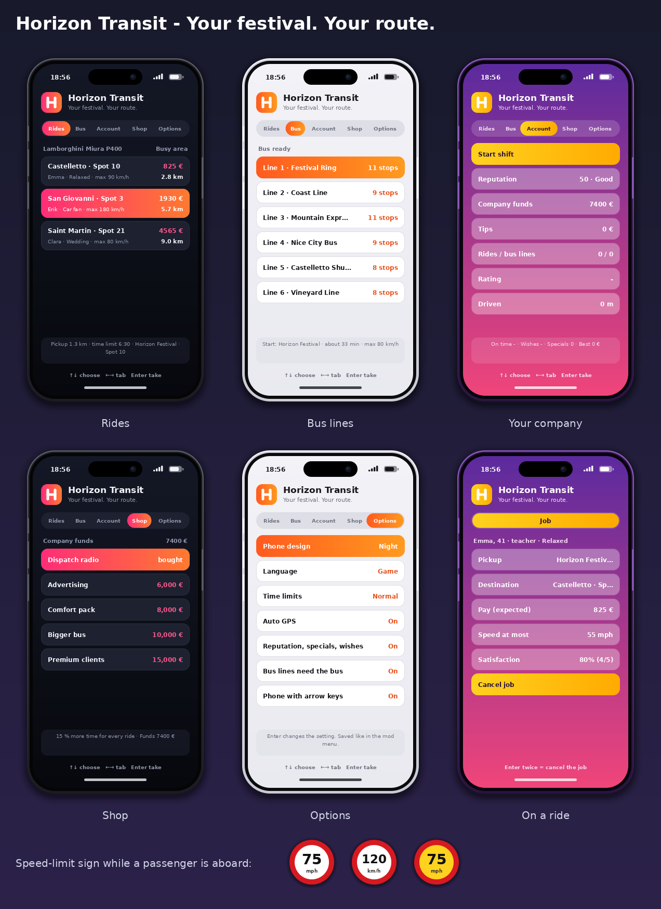
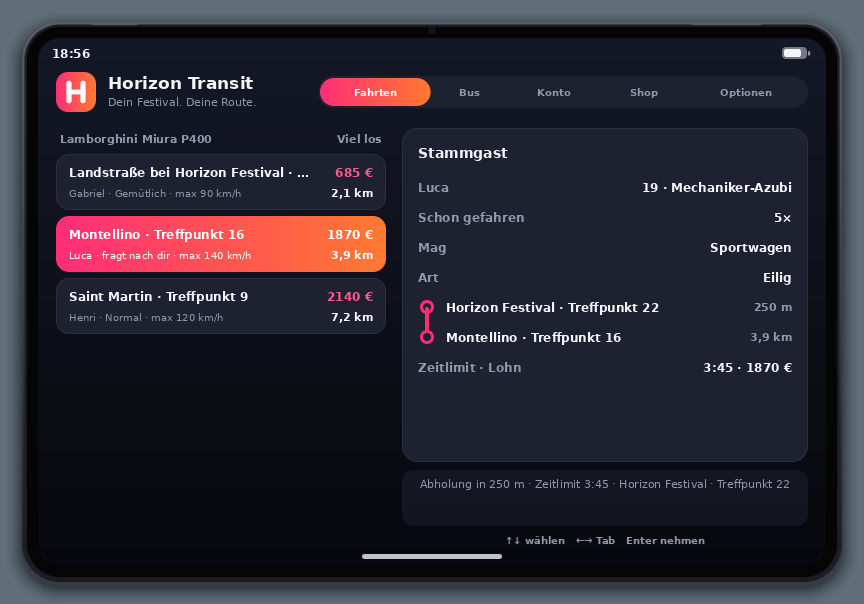

# Horizon Transit

**Your festival. Your route.** · *Dein Festival. Deine Route.*

A ride-hailing and bus-line mod for **Forza Horizon 2 on PC**: take Uber-style rides and drive bus lines with virtual passengers who talk, remember you and rate your driving. Everything runs from a phone on the left of the screen (**F9**).
One mod, one file (`TransportSim.dll`), for the [FH2 Mod Platform](https://github.com/Trinculo54/fh2-mod-platform). Texts in English and German.

**[⬇ Download the latest version](../../releases/latest)** · current version: **0.9.1**

> Horizon Transit is new and in active development. The release list shows what is new.

Pictures drawn by the mod's own phone code (the preview tool uses a stand-in font). More in [docs/screenshots](docs/screenshots).

---

## What you get

### 🚕 Rides
- **3 requests nearby** on the phone, short, medium and long, at 139 real places taken from the game's files: the festival, the towns, the **bus stops the map makers put up**, the game's **car parks** and a few spots in the countryside. No stop on a motorway or at the car meet.
- The game's **GPS** guides you to the pickup and on to the destination. Stop there and the passenger gets in or out: **a door really opens and closes with its sound** (rear left, rear right or front passenger; right-hand-drive cars are recognised).
- **Satisfaction** from your driving: hard throttle, braking, cornering, speeding and crashes cost, calm driving pays back. Every passenger has a speed limit, shown as a sign top left (mph or km/h, as the game is set). **Pay and 1–5 stars** at the end.
- **40 passengers with a life**: name, age, job and a story they tell bit by bit. Regulars know you, remember your last car and how the last ride went.
- **Passenger kinds**: normal, relaxed, in a hurry, car fan, and special rides: **VIP**, **business client**, **wedding couple**, **day trip**.
- **Your car matters**: the mod knows all 353 cars of the game and their Autoshow group. People like or dislike groups; a saloon brings business clients, a classic a wedding, an off-roader a day trip.
- **Wishes on the way**: "slower please", "nice and smooth", "show me what it can do", or a **quick stop** somewhere (the GPS goes there first).
- About **640 lines** of dialogue, never the same twice in a row. Passengers sometimes **ask you something**: answer with **B** or **LB + RB + D-pad down**, and your driver replies.

### 🚌 Bus lines
- **6 lines** with 8–12 stops; the Nice city bus runs through the game's real bus stops. Passengers get on and off at every stop, always adding up (never more out than on board, 40 seats).
- A **timetable** for every line: "due in 1:20" or "late +0:45", and at the end "on time at 8 of 10 stops".
- Lines run **both ways** (from the nearer end; rings the other way round every second time), with **stop announcements** ("Next stop: …", read out with Voices on). Nobody wants off or on? **No stop requested**: drive through.
- Bus lines need the game's bus by default (switchable).
- *Experimental:* the game's **traffic bus in the Autoshow** (group of the Ford Transit SSV). The mod changes the game's database questions while it runs, so the database file stays untouched and it also works with the FH2MP launcher.

### 🏢 Your company
- **Reputation** 0–100: good ratings raise it, it pays a little more and brings special rides.
- **Company funds**: what you earn goes into your own company's funds (kept apart from your save's credits).
- **Shop**: dispatch radio, advertising, comfort pack, bigger bus, premium clients.
- **Workday**: your shift starts with your first job (or by hand) and ends with a statement (rides, km, stars, tips, best ride). On shift, **requests pop up** by themselves, and a **day's goal** (5 jobs, 4 stars on average) pays a bonus.
- **Streak**: from the third 4- or 5-star job in a row, a bonus on each. **Regulars ask for you** by name, and now and then someone **leaves something in your car**.
- **Statistics**: tips, punctuality, wishes, special rides, records.

### 📱 The phone (or tablet)
- A drawn smartphone on the left, in 7 designs (Night, Light, Festival, Ocean, Carbon, Riviera, Gold). Works with the arrow keys or a pad.
- **Three devices** (new in 0.5): the phone, the slim **Edge** (punch-hole camera, Android keys) and a landscape **tablet** that shows the passenger's profile, the line's stops as a route map and your logbook next to the list.

 
- **Map tab**: a dark map with the game's own roads, your position, the towns, hotspots, a preview of each ride before you take it and the way during a job. The mod builds the map at start from your own game files (the pause menu's map picture and the game's road network): nothing of the game is in the mod and no extra file is needed.
- Tabs: Rides · Bus · Map · Account · Shop · Options. Arrow keys, Enter and Backspace while it is open; most settings also in the phone (Options).

---

## Install

You need Forza Horizon 2 (Xbox One version 1.0.0.64) running with **Azimuth 1.0.4** and the **FH2 Mod Platform 2.9.0** (the FH2MP launcher installs it).

1. Start the game once with the platform installed.
2. Copy `fh2-mods\TransportSim.dll` from the release ZIP next to `azimuth.exe` (into `fh2-mods`).
3. With the FH2MP launcher: Pause › MODS › Installed mods › Horizon Transit › *Load when playing online* = On. (The mod is meant for offline play; FH2MP counts every start from its launcher as online.)
4. Start the game, drive a few metres and press **F9**.

**Uninstall:** delete `fh2-mods\TransportSim.dll`. Its settings, company and logs are in `Azimuth\TransportSim\` (delete it too if you like). Horizon Transit never changes the game's files or your save.

## Keys

| Key | Controller | Function |
|---|---|---|
| F9 | LB + RB + D-pad up | Phone on / off |
| F10 | LB + RB + D-pad right | Next entry |
| F11 | LB + RB + A | Take. During a job: twice = cancel |
| B | LB + RB + D-pad down | Answer a passenger's question |
| ↑ ↓ ← → Enter Backspace | – | While the phone is open: choose, tabs, take, close |

All keys can be changed in Pause › MODS › YOUR MODS › Horizon Transit. LB is NitroSystem's nitro button, so the controller chords can fire nitro.

---

## Problems?

- Send `Azimuth\TransportSim\logs\` (newest file) and `fh2-mods\platform.log` with a GitHub [issue](../../issues/new).

Known limits

- The mod has its own money (company funds); there is no known safe way to change the game's credits.
- The game's time of day and weather can't be read, so there is no demand by time or weather. Music and windows can't be controlled, so there are no wishes about them.
- Distances and time limits are estimated (straight line × 1.35), not read from the GPS route.
- The phone is its own window over the game: invisible in exclusive fullscreen, so play windowed or borderless.
- Cars from car packs have no data and count as normal cars without a group.
- The traffic bus in the Autoshow is experimental: cameras, cockpit and driver may be missing. Don't buy or drive it online.
- Not tested together with races and events during a job; cancel the job first.

> 🚨 **Security:** Horizon Transit is only `TransportSim.dll`. It never asks you to paste commands into PowerShell or to run an installer. Download it only from this repository's releases or build it yourself.
>
> ⚠️ **Unofficial.** Not supported by the FH2 Mod Platform author, the FH2MP team or the Azimuth developer.

---

## Credits
- **[Almost There Games](https://almost-there-games.itch.io/azimuth)** – Azimuth (not included)
- **[Trinculo54](https://github.com/Trinculo54/fh2-mod-platform)** – FH2 Mod Platform; Horizon Transit uses its MIT API headers (`third_party/fh2mod`)
- **[Flenkii](https://github.com/Flenkii)** – idea, testing, maintainer (also [Gripline](https://github.com/Flenkii/Gripline))
- **Claude (Anthropic)** – wrote the code together with Flenkii
- Door sounds: **Sounds From The Lab** (royalty-free)
- How the game opens car doors in free roam was learned from **[Extra Options](https://github.com/RokkuDayo/ForzaHorizon2_ExtraOptions)** (its roof) and **Gripline** (no code taken, only how it works)
- Works well with **Gripline**, **[FH2 ANNA](https://github.com/qiangqiang101/FH2_ANNA)** and **[NitroSystem](https://github.com/qiangqiang101/NitroSystem)**

## Building and license
`pip install ziglang==0.15.2`, then `python build.py`: it runs the logic tests (9774 checks) and makes `out/TransportSim.dll`. The game data tables are made by `tools/gen_stops.py` (from `media/tracks/anthem`) and `tools/gen_cars.py` from your own game files.
GPL-3.0 (see [LICENSE](LICENSE)). Changes: [CHANGELOG.md](CHANGELOG.md) · plan of the ideas (German): [docs/ROADMAP_de.md](docs/ROADMAP_de.md).

## AI disclosure
The code of Horizon Transit was written with the help of an AI (Claude by Anthropic) and tested with automatic tests and in the game.
