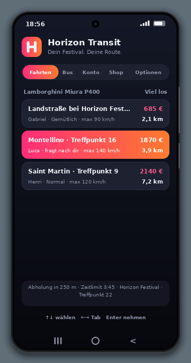
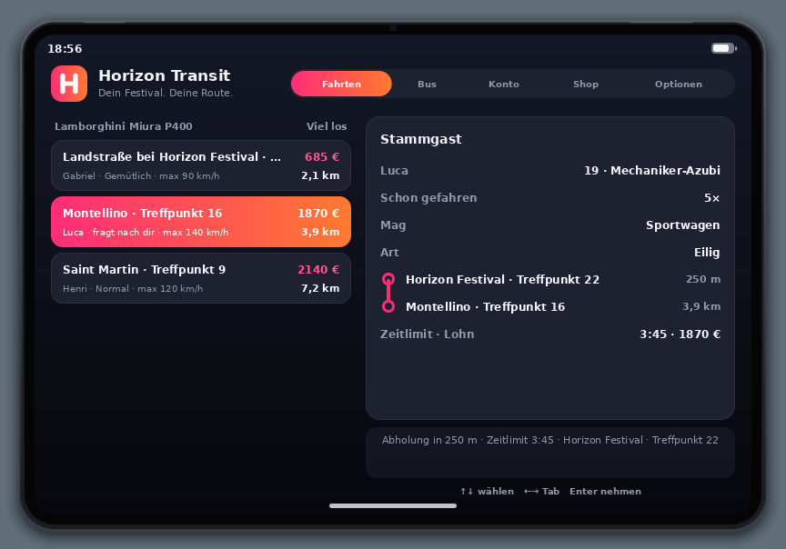
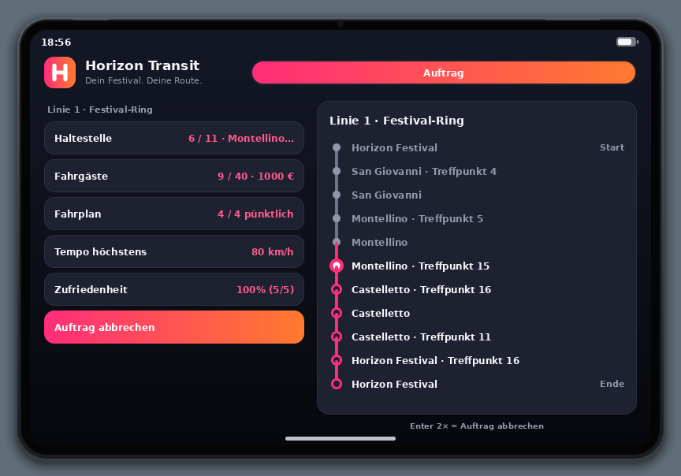

# Horizon Transit: Ideen für 1.0.0

Stand: 20.11.2026, nach Version 0.4.3. Umgesetzt in **0.5.0**.

Leitlinie: Alles soll sich anfühlen, als wäre es schon immer in Forza Horizon 2 gewesen. Deshalb gibt es keine neuen Menüs oder Schalter, wo es nicht nötig ist. Neue Dinge kommen dort hin, wo der Spieler ohnehin hinschaut: aufs Handy, in die Fahrt-Anzeige am Tacho, in die Pop-ups des Spiels.

## Woher die Ideen kommen

- **Marvin:** andere Handy-Designs (Samsung-artig), ein Tablet zum Umschalten.
- **Spielerwünsche im Internet** (gelesen am 20.11.2026):
  - Bus Simulator 18, Steam-Thread „Ten things I would like in a game like this“: automatische Haltestellenansagen, Haltestellen nach Bedarf, Fahrpläne. [Link](https://steamcommunity.com/app/515180/discussions/0/1697174779852728343/)
  - GTA-V-Mod „Bus Simulator V“: Ansagen per Sprachausgabe, Zielanzeige pro Linie, eigene Routen. Gelobt wird, dass man nicht pixelgenau halten muss. [Link](https://www.gta5-mods.com/scripts/bus-simulator-v)
  - GTA-V-Mod „Los Santos Bus Service“: Haltewunsch-Knopf, Ansagen, Linienwechsel ohne Depot, „im Dienst / außer Dienst“, Fahrgeld-Anzeige. [Link](https://www.gta5-mods.com/de/scripts/los-santos-bus-service-ride-as-client)
  - Forza-Foren und Presse: Spieler wünschen sich „GTA-artige Nebenjobs“ (Forza-Forum, Thread „Game Mode: GTA-style odd job sub-missions“), Forza Horizon 4 hatte Taxi-Missionen im Stil von Crazy Taxi, Forza Horizon 5 hat „Isha's Taxis“. Die Forum-Threads selbst waren für mich nicht lesbar (Weiterleitung bzw. gesperrt), daher nur die Titel.
- **Eigene Ideen** aus dem, was echte Fahrdienst- und Bus-Apps haben.

## Die Liste

### Umgesetzt (15)

| # | Idee | Herkunft | Wie es im Spiel aussieht |
|---|---|---|---|
| 1 | **Edge-Handy** (Samsung-artig) | Marvin | Neues Gerät „Edge“: schmale Ränder, kantigere Ecken, Kamera-Loch statt Insel, Uhr links wie bei Android, unten die drei Android-Tasten, Tasten nur rechts. Alle 7 Designs passen. |
| 2 | **Tablet** | Marvin | Neues Gerät „Tablet“, quer. Oben App-Name und Tabs in einer Leiste, links die Liste wie am Handy, rechts eine zweite Spalte mit Details (siehe 13 bis 15). Umschalten: Handy > Optionen > Gerät oder Mod-Menü. |
| 3 | **Linien in beide Richtungen** | Linienfahren | Startest du eine Linie näher an ihrer Endhaltestelle, fährt sie rückwärts. Ringlinien fahren jedes zweite Mal andersherum. Der Bus-Tab zeigt „Start → Ende“. |
| 4 | **Haltestellenansagen** | Bus Simulator 18, Bus Simulator V | Statt eines Pop-ups beim Losfahren: „Ansage: Nächster Halt: Montellino.“ An der letzten: „Endhaltestelle, bitte alle aussteigen.“ Mit „Stimmen“ an wird sie vorgelesen. |
| 5 | **Haltewunsch und Durchfahren** | Los Santos Bus Service | Will an einer Haltestelle niemand aus- oder einsteigen, sagt die Ansage „Kein Haltewunsch“ und du darfst durchfahren. Will jemand aussteigen, kommt ein kurzer Ton wie beim Halteknopf. Fahrplan und Fahrgeld zählen trotzdem. |
| 6 | **Push-Anfragen im Dienst** | Uber-App, „im Dienst“ aus LSBS | Läuft deine Schicht und du fährst ohne Auftrag herum, kommt alle 2 bis 3 Minuten eine Anfrage als Pop-up („Neue Anfrage · 640 €“). F9 öffnet das Handy mit genau dieser Anfrage oben. Ohne Schicht kommt nichts. |
| 7 | **Stammgast fragt nach dir** | eigene | Wer schon zweimal mit dir gefahren ist, fragt ab und zu direkt nach dir: „Lena · fragt nach dir“, 15 % mehr Lohn. Höchstens einer pro Liste. |
| 8 | **Fundsachen** | eigene | Manchmal (7 %) ruft ein Fahrgast kurz nach dem Aussteigen an: „Meine Schlüssel liegen noch bei dir im Auto!“ Das GPS zeigt zurück. Bringst du es rechtzeitig, gibt es 60 € und Ruf +1. Sonst geht es „per Post“ zurück, ohne Abzug. |
| 9 | **Serie** | eigene | Aufträge mit 4 oder 5 Sternen hintereinander. Ab dem dritten gibt es 5 % Bonus pro Auftrag, höchstens 20 %. Ein schlechter Auftrag oder ein Abbruch beendet die Serie. |
| 10 | **Tagesziel** | eigene | Beim Schichtbeginn: 5 Aufträge mit im Schnitt 4 Sternen. Geschafft = 250 € Bonus, einmal pro Schicht. |
| 11 | **Taxameter** | Taxi-Spiele, GTA | In der Fahrt-Anzeige am Tacho läuft rechts unten der Fahrpreis mit, je nach gefahrener Strecke bis zum vereinbarten Preis. |
| 12 | **Fahrgeld-Kasse im Bus** | LSBS (Fahrgeld-Anzeige) | Im Bus zeigt dieselbe Stelle das bisher eingenommene Fahrgeld. |
| 13 | **Streckenplan der Linie** | Zielanzeige, Netzpläne | Tablet: Haltestellen als Linie mit Punkten, wie auf einem Netzplan. Während der Fahrt sind gefahrene Halte grau und der nächste Halt groß markiert. |
| 14 | **Fahrgast-Profil vor dem Annehmen** | eigene | Tablet: Name, Alter, Beruf, wie oft ihr schon gefahren seid, welche Autos die Person mag, Abholort und Ziel, Zeitlimit und Lohn. |
| 15 | **Fahrtenbuch** | eigene | Tablet, Tab Konto: die letzten 5 Aufträge mit Lohn und Sternen, dazu Tagesziel und Serie. |

### Schon vorhanden (aus den Wünschen, nichts zu tun)

- „Im Dienst / außer Dienst“: gibt es seit 0.4.0 als Schicht im Konto-Tab.
- Nicht pixelgenau halten müssen: die Mod zählt 30 m (90 m, wenn das GPS „angekommen“ meldet).
- Türen beim Ein- und Aussteigen: seit 0.4.3 im Fahrdienst.
- Fahrpläne mit Pünktlichkeit: seit 0.4.0.

### Nicht machbar oder bewusst weggelassen (10)

| # | Idee | Warum nicht |
|---|---|---|
| 16 | Sichtbare Fahrgäste und Fußgänger | FH2 hat keine Fußgänger-Modelle und keine Animation dafür. Die Mod kann keine Figuren ins Spiel setzen. |
| 17 | Lohn als echte Credits | Es ist kein sicherer Weg bekannt, das Spielkonto zu ändern. Die Mod bleibt bei der Firmenkasse. |
| 18 | Rushhour, Nachtschwärmer, Wetter | Uhrzeit und Wetter des Spiels kann die Mod nicht auslesen. Die PC-Uhr passt nicht zur Sonne im Spiel. |
| 19 | Taxi-Schild auf dem Dach, Zielanzeige außen am Bus | Die Plattform kann keine Modelle oder Texturen ans Auto hängen. |
| 20 | Echte gesprochene Dialoge wie bei Isha's Taxis | Dafür bräuchte es aufgenommene Stimmen. Die Mod hat nur die Windows-Stimmen (Schalter „Stimmen“). |
| 21 | Andere Busse und Fahrer im Verkehr | Die Mod kann keine Autos mit eigener Route ins Spiel setzen. |
| 22 | Tablet mit Maus oder Touch bedienen | Das Handy-Fenster muss durchklickbar bleiben, sonst nimmt es dem Spiel den Fokus. Bedienung bleibt bei Pfeiltasten und Pad. |
| 23 | Radio oder Musikwunsch | Die Mod kann die Musik des Spiels nicht steuern. |
| 24 | Freunde im Mehrspieler als Fahrgäste (FH2MP) | FH2MP bietet dafür keine Schnittstelle. |
| 25 | Eigene Routen bauen, Busdepot, Müll im Bus | Wäre machbar, aber würde die Mod überladen. Bewusst weggelassen. |

## Technisch

- Neue Datei `src/core/service.c`: Push-Anfragen, Fundsachen, Serie, Fahrtenbuch, Taxameter und die Tablet-Spalte. Tagesziel in `career.c`, Linien rückwärts, Ansagen und Haltewunsch in `jobs.c` und `timetable.c`.
- Geräte in `src/core/phone_draw.c`: `ts_device_size/draw/finish` mit `TS_DEVICE_PHONE`, `TS_DEVICE_EDGE`, `TS_DEVICE_TABLET`. Das Handy sieht genau aus wie bisher.
- Neue Einstellung `Device` in `TransportSim.ini` und im Mod-Menü. Im Handy steht sie unter Optionen ganz oben. Dafür ist „Buslinien nur im Bus“ dort raus (im Mod-Menü bleibt sie).
- Die Serie, das Fahrtenbuch und eine laufende Fundsache werden nicht gespeichert (wie die Schicht).
- 8898 automatische Prüfungen, alle bestanden, inklusive Bildern aller Tabs auf Edge und Tablet in allen Designs.
- **Im Spiel noch ungetestet.**

## Bilder

Aus der Vorschau der Mod (gleicher Zeichencode wie im Spiel, nur mit einer Ersatzschrift):

 

## 0.5.1: Marvins Ideen vom 20.11.

| Idee | Umgesetzt | Hinweis |
|---|---|---|
| Warnton bei Gelb (einmal) und Dauer-Ding-Ding bei Rot | ja | `src/core/chimes.c` entscheidet, `mod.c` spielt über waveOut (mehrere Töne gleichzeitig). |
| Mehr Sounds, alle in der DLL | ja | Gong, Haltewunsch-Glocke, Anfrage-Ping, Kassen-Klang. Alle synthetisch (`tools/gen_sounds.py`). |
| Tempo-Wünsche für die ganze Fahrt | ja | Alle Wünsche gelten jetzt bis zum Ziel, keine Uhr mehr. |
| Vollgas-Wunsch in Supersportwagen | ja | Nur moderne Autos der Gruppe „Super“ (ab Baujahr 1985, ohne Gurkha). |
| Antworten wie in Cyberpunk, nur Tastatur | ja | Taste B (frei bei allen installierten Mods). Fragen nur, wenn mit der Tastatur gefahren wird. |
| Eigene Fahrerstimme | teilweise | Windows-Sprachausgabe (SAPI): feste männliche Stimme mit fester tiefer Tonlage, die kein Fahrgast hat. Auf Englisch ist das „David“. Für Deutsch hat Windows über SAPI meist nur „Hedda“ (weiblich); dann klingt der Fahrer wie eine tief gestellte Hedda. Eine echte deutsche Männerstimme (z. B. „Stefan“) erreicht SAPI ohne Umbau der Windows-Registry nicht. |
| App schicker | ja | Fortschritts- und Bewertungsbalken unter den Einträgen. |
